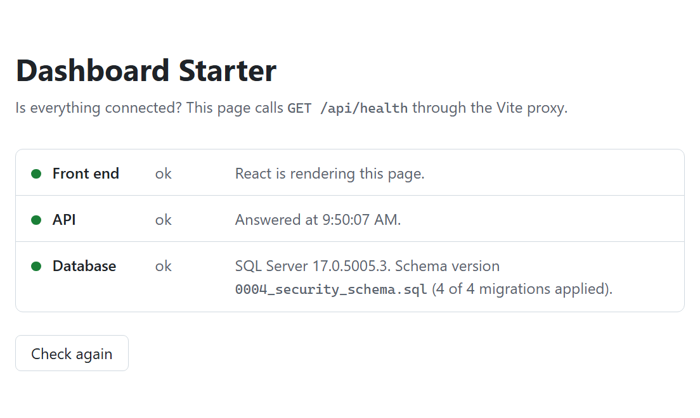

# dashboard-starter

An opinionated, open-source dashboard starter for building real business apps with **React**, **C# / ASP.NET Core**, and **SQL Server**.

Clone it, rename it, and start on your actual product instead of rebuilding auth, layout, and plumbing for the tenth time.

**Live demo:** [dashboard.mvmorten.com](https://dashboard.mvmorten.com). It's deployed from `main` on every merge, so it always shows the latest step. Sign in with the shared demo account: the sign-in page shows its email and password, and **Use demo account** fills them in. Everyone uses the same account, so don't put anything private in it. The account belongs to two tenants, "Demo" and "Other Demo": switch between them at the top, and the user menu at the top right signs you out. You land in the tenant the account used last, so with a shared account that may be whichever one the last visitor picked. The account is an Admin in "Demo" and Read-only in "Other Demo", so the Members page shows the same person with different permissions in each. Because it's shared, it can look at an admin's controls but not use them.

> **Status:** Just getting started. This project is being built in public, and every step is documented in a blog series. Expect the code to change quickly while the foundation takes shape.

---

## Why this exists

Most starter templates fall into one of two camps: a pretty UI with no real backend, or a backend sample with no usable front end. Very few show how a full production app fits together end to end, and fewer still explain *why* each decision was made.

**This project is for developers who want to understand the whole stack.** You should be able to follow any feature from a React component, through the API, to the exact SQL it runs, without digging through framework internals. Most of the choices below follow from that: when a tool does a lot of work you can't see, we usually pick the plainer option you can read.

This repo aims to be:

- **Usable.** A working dashboard you can fork and ship on.
- **Opinionated.** One clear way to do things, not a menu of every option.
- **Explained.** Every major decision is written up in the accompanying blog posts, so you can disagree with it knowingly.

## The stack

| Layer | Choice |
| --- | --- |
| Front end | React + TypeScript, built with Vite. Plain CSS (no UI kit), React Router for pages, TanStack Query for server data |
| API | ASP.NET Core Web API with controllers (C#, current .NET LTS) |
| Database | SQL Server, one shared database for all tenants |
| Data access | Dapper, with hand-written SQL inline in C# |
| Schema changes | Idempotent SQL scripts in `/sql`, applied by an explicit command |
| Multi-tenancy | `TenantId` on every tenant-owned table, backed by SQL Server Row-Level Security |
| Auth | Our own user tables, Argon2id password hashing, ASP.NET Core cookie authentication |
| Email | [Resend](https://resend.com)'s REST API through a plain `HttpClient`, behind an `IEmailSender` interface; locally, emails are text files in `.dev-mail/` |
| Local dev | Docker Compose runs SQL Server only; the API and front end run natively |
| CI and deploy | GitHub Actions: build, lint, and schema checks on every pull request; deploy on every merge to `main` |
| Hosting | Azure App Service (Linux) serving the API and the React build, Azure SQL Database, both created from Bicep in `/infra` |

## Multi-tenancy

- **One shared database, many tenants.** One schema, one migration run, one backup, one connection string. That's the economy of scale that makes SaaS work. See the FAQ for why not one database per tenant.
- **One account, many tenants.** A person signs in once and can belong to several tenants. Nobody wants a separate account for every organization they work with.
- **Global tables** have no `TenantId`: `Users`, `Tenants`, `TenantUsers`, and the role definitions (`Roles`, `RolePermissions`). Your account, email (unique across the system), password hash, and lockout state belong to you, not to any one tenant.
- **Everything else is tenant-owned**: it carries a `TenantId`, the `TenantId` leads its indexes, and every query filters by the current tenant.
- **Row-Level Security is the safety net.** The API puts the current tenant in `SESSION_CONTEXT` on each connection, and a security policy filters every tenant-owned table. A query that forgets its `WHERE TenantId = @TenantId` still can't see another tenant's rows.
- **Roles are per tenant.** You can be an admin in one tenant and read-only in another: each membership in `TenantUsers` has exactly one `RoleId`. See "Roles and permissions" below.
- **Switching tenants.** With one tenant you go straight in. With several, you land in the one you used last and can switch from the top bar. The auth cookie holds your user and current tenant; switching checks your membership and issues a new cookie.
- **Removing access works right away.** Memberships can be disabled per tenant, and the API rechecks membership on each request, cached for at most a minute (`Auth:SessionCheckSeconds`). The same check ends every session of a user whose password changed or who is locked out.
- The development seed creates the same demo account as the live demo, in its two tenants ("Demo" and "Other Demo"), plus two sample tenants for your own test users. A real deployment starts empty: create your first tenant, and if your app only ever needs one, you can ignore the rest.

## Roles and permissions

- **Code checks permissions, never role names.** A permission is an area and an action: `members.view`, `members.manage`. They're all listed in one file, [`src/Db/Authorization/Permissions.cs`](src/Db/Authorization/Permissions.cs), each with a line saying what it allows.
- **A role is a named set of permissions**, defined in the database by a migration (`sql/migrations/0009_roles.sql`) and the same in every tenant. There's no screen for editing roles: they're part of the app's design, like its tables.

  | Role | Permissions |
  | --- | --- |
  | Admin | `members.view`, `members.manage` |
  | Member | `members.view` |
  | Read-only | `members.view` |

  Member and Read-only are the same until there's data to change. The CRUD module adds its own permissions (an `edit` for its records) and grants them to Admin and Member only.
- **One role per membership.** It's a `RoleId` column on `TenantUsers` rather than a separate table, so "exactly one role in each tenant" is kept by the schema itself. New memberships get Member unless you say otherwise.
- **The API checks every request.** Controllers say `[Authorize(Policy = Permissions.MembersManage)]`, and one small handler we own (`src/Api/Auth/PermissionHandler.cs`) answers it. The permissions come from the database with the per-request session check (cached for at most `Auth:SessionCheckSeconds`), never from the cookie, so a changed role or a disabled membership takes effect within a minute, and usually on the very next request when it's changed on the Members page. Not signed in is a 401; signed in without the permission is a 403.
- **The UI only hides things.** `/api/auth/me` returns your permissions in the current tenant, and one helper, `can(permission)` (`src/Web/src/auth/permissions.ts`), hides menu items and buttons you can't use. That's a convenience; the API is the check.
- **Every tenant keeps an admin.** You can't change your own role or disable yourself, and no change may leave a tenant without an active member who can manage members. The rule is in one place (`src/Db/Users/Memberships.cs`), used by the API and the Db runner, and runs in one transaction with the change, under a lock on the tenant, so two admins demoting each other at once can't both succeed.
- **Adding a permission in a fork:** add a constant to `Permissions.cs` (and to the front end's copy in `permissions.ts` if the UI needs it), write a migration that grants it to the roles that should have it, and put `[Authorize(Policy = ...)]` on the endpoints. CI fails if the code and the database don't list the same permissions.

## Database conventions

- **Dapper, not an ORM.** Queries are plain SQL you can read, tune, and run in SSMS.
- **Inline SQL, parameters only.** Queries live in the C# that uses them, written as raw string literals (`"""`). Values always go in as parameters, never with `$` string interpolation. Dynamic pieces, like a sortable column, come only from a fixed list in code, never straight from user input.
- **Stored procedures only where they help**, such as set-based batch work or heavy reporting. See the FAQ.
- **Keys:** `int` identity on every table, `bigint` on tables that grow without limit (audit log, events). Links that must be unguessable, like password resets and invites, use random tokens, not IDs.
- **Standard columns** on every tenant-owned table: `TenantId`, `CreatedAt`, `CreatedBy`, `UpdatedAt`, `UpdatedBy` (`datetime2`, UTC), and `RowVersion`.
- **Optimistic concurrency with `rowversion`.** Every read returns the row's version. Every update includes it (`WHERE Id = @Id AND RowVersion = @RowVersion`). If someone else saved first, the API returns `409 Conflict` instead of silently overwriting their change. Always write `rowversion`, never `timestamp`: same type, but `timestamp` is the old name and looks like a date.
- **History:** system-versioned temporal tables keep every past version of a row, so the audit log doesn't depend on triggers.

### Schema scripts

```
/sql
  /migrations     run once, in order: tables, columns, indexes, data fixes
  /programmable   rerun every time: views, functions, procs, RLS predicates
  /seed           development only: sample data (the demo account is made in C#, see below)
```

- **Migrations** are numbered (`0001_tenants.sql`, `0002_users.sql`, ...) and idempotent: each checks before it changes (`IF NOT EXISTS`, `IF COL_LENGTH(...) IS NULL`), so running one twice is safe. Once a migration has run, it's never edited. A change is a new script.
- **Programmable** objects use `CREATE OR ALTER` and are edited in place. The file is the definition.
- **Applying them is a command you run on purpose:**

  ```
  dotnet run --project src/Db -- migrate    # migrations + programmable objects
  dotnet run --project src/Db -- seed       # development only
  ```

  The runner records each migration in a `SchemaVersions` table with a hash of its contents, skips ones already applied, and fails loudly if an applied script was edited. The same command runs on your laptop, in CI, and in deployment.
- **The API never changes the database.** On startup it only checks that the schema is current. If it isn't, it refuses to start and tells you which command to run.
- **Running a copied query in SSMS?** Set the tenant first, or Row-Level Security will return no rows:

  ```sql
  EXEC sp_set_session_context @key = N'TenantId', @value = 1;
  ```

## Code conventions

Mostly style, written down so contributors know what to expect. Enforced by `.editorconfig`, ESLint, and Prettier rather than code review.

- **2-space indentation everywhere**, spaces not tabs: C#, TypeScript, SQL, JSON, YAML. Yes, the .NET default is 4. Two is on purpose.
- **Braces always.** No single-line `if` statements, in C# or TypeScript.
- **Prefer early returns over nesting.** Guard clauses at the top of a method instead of wrapping the body in an `if`. If you're indented 14 levels deep, the indent width isn't the problem.
- **Brace placement** follows each language's default: own line in C#, same line in TypeScript.
- **C#:** a classic `Program` class with `Main` (no top-level statements), implicit usings off so every file lists its own `using` lines, file-scoped namespaces, and nullable reference types on.
- **Front end:** standard Prettier formatting, with ESLint enforcing braces.
- **Mobile first.** The base CSS targets a phone, and `min-width` media queries add the larger layouts. Every screen has to work at 390 px wide without the page scrolling sideways; wide content like data grids scrolls inside its own container. Touch targets are at least 44 px, and nothing is reachable only by hover.
- **Logging:** the built-in `Microsoft.Extensions.Logging` with the console provider. Always inject `ILogger<T>`, so every message is tagged with the class that wrote it. Write message templates with named placeholders, `_logger.LogInformation("Applied {Migration}", name)`, never string interpolation: interpolation loses the named values and builds the string even when that log level is off. The build enforces this (rule CA2254). Never log secrets: passwords, connection strings, tokens, cookies. Per-request scopes, JSON output, and a global exception handler come in later steps. The Db runner is a command-line tool, so it prints its results with `Console` directly; that's output, not logging.

## Dependencies

Every package is code someone else wrote that we have to keep up to date and trust, so the default is what's already there: .NET and ASP.NET Core, the browser's own APIs, and React. A library has to earn its place through **necessity** (there's no built-in way to do it), **safety** (it closes a security hole), or a **real gain in correctness** (Dapper: hand-written row mapping is repetitive, error-prone code). Saving a few lines isn't enough on its own.

It's a principle, loosely held: it guides the decision, it doesn't rule out good libraries. Each new dependency is justified in the pull request that adds it and listed here.

| Package | Where | Why it's here |
| --- | --- | --- |
| `Dapper` | API, Db runner | Maps query results to C# objects. Hand-written row mapping (column names as strings, casts, null checks) is repetitive code that breaks quietly. Dapper does only that; the SQL stays ours. |
| `Microsoft.Data.SqlClient` | API, Db runner | The SQL Server driver. .NET doesn't ship one; this is Microsoft's. |
| `Konscious.Security.Cryptography.Argon2` | API, Db runner | Argon2id password hashing. .NET has no built-in Argon2, and the built-in alternative (PBKDF2) isn't memory-hard, so a GPU can try passwords far faster. Earns its place on safety. It does the algorithm only; the salt, the PHC format, constant-time comparison, and rehashing are our code (`src/Db/Passwords`). Checked against the reference implementation (argon2-cffi) in both directions. |
| `Azure.Extensions.AspNetCore.DataProtection.Blobs` | API | Keeps the Data Protection keys (which encrypt the sign-in cookie) in Azure Blob Storage, so a deploy or restart doesn't sign everyone out. Only used when `DataProtection__BlobUri` is set. |
| `Azure.Extensions.AspNetCore.DataProtection.Keys` | API | Encrypts those keys with a Key Vault key that never leaves the vault, so a copy of the blob alone is useless. Safety. |
| `Azure.Identity` | API | Lets the app sign in to Storage and Key Vault with its managed identity, so no storage key or secret sits in its settings. |
| `System.Security.Cryptography.Pkcs` | Security pin | Not used directly. SqlClient 7.1.1 pulls in 9.0.18, which has two denial-of-service advisories, so `Directory.Packages.props` pins it to the patched 10.0.13. Remove the pin once SqlClient depends on a patched version itself. |
| `react`, `react-dom` | Front end | The UI library the front end is built on. |
| `react-router` | Front end | Client-side routing: the URL changes and the right page renders without a reload, and back, forward, and deep links work. The browser has no built-in way to do that for a single-page app. We use only the declarative parts (`BrowserRouter`, `Routes`, `Route`, `NavLink`), not its data loaders or framework mode, so data fetching stays in our own code. |
| `@tanstack/react-query` | Front end | Server data: caching, sharing one request between components, and re-checking when the tab regains focus. Doing that by hand with `useEffect` is where stale data, double requests, and missed cancellations come from, so this is a gain in correctness. It sits on a plain `fetch` client (`src/Web/src/api.ts`), with one hook per resource. |
| `@tanstack/react-query-devtools` | Front end, dev | A panel that shows what is cached and why. Loaded in development only; a production build leaves it out. |
| `vite` | Front end, dev | Dev server (including the `/api` proxy) and production bundler. |
| `@vitejs/plugin-react` | Front end, dev | Lets Vite compile JSX and reload components in place while you edit. |
| `typescript` | Front end, dev | Type checking; `npm run build` fails on type errors. Pinned to 6.0.x until `typescript-eslint` supports TypeScript 7. |
| `@types/react`, `@types/react-dom` | Front end, dev | Type definitions for React. |
| `@types/node` | Front end, dev | Types for `vite.config.ts`, which runs in Node, not the browser. Kept on the same major as the Node version CI uses (24), so the types only describe APIs that version has. |
| `eslint`, `@eslint/js` | Front end, dev | Linting, with ESLint's recommended JavaScript rules. |
| `typescript-eslint` | Front end, dev | Lets ESLint read TypeScript and adds TypeScript-aware rules. |
| `eslint-plugin-react-hooks` | Front end, dev | Catches broken hook usage and missing effect dependencies, which are real bugs, not style. |
| `eslint-plugin-react-refresh` | Front end, dev | Warns when a file's exports would stop Vite's in-place reload from working. |
| `globals` | Front end, dev | Tells ESLint which browser globals exist (`window`, `document`), so they aren't flagged as undefined. |
| `prettier` | Front end, dev | Formatting, so style never comes up in review. Pinned to an exact version, because formatting can change between releases. |
| `eslint-config-prettier` | Front end, dev | Turns off ESLint rules that would fight Prettier's formatting. |

"Dev" packages are build and editor tooling; they aren't shipped to the browser.

**Services, not packages.** Password reset emails go through [Resend](https://resend.com). It's a service the API calls over HTTP, not a package: one POST with a plain `HttpClient` (`src/Api/Email/ResendEmailSender.cs`), so there's no SDK to keep up to date. It only runs when its settings are present, and swapping it for another service means writing one class that implements `IEmailSender`.

`src/Web/package.json` also has one `overrides` entry: it forces `minimatch` (the glob matcher inside ESLint and `typescript-eslint`) up to 11.0.4, because 10.x has a denial-of-service bug ([GHSA-g3hv-75wg-m249](https://github.com/advisories/GHSA-g3hv-75wg-m249)) and those packages still ask for 10.x. It's dev tooling only, and lint was checked against it. Remove the override once ESLint and `typescript-eslint` depend on minimatch 11 themselves.

## What it will include

The goal is the 80% every dashboard app needs on day one:

- [x] Solution layout: front end, API, and database projects in one repo
- [x] Local dev environment with Docker Compose and seeded data
- [x] App shell: sidebar navigation, top bar with tenant switcher, responsive layout, light and dark themes
- [x] Authentication: sign in and sign out, lockout, a shared demo account
- [x] Password reset and change password
- [ ] Tenants: one account across tenants, tenant-scoped data, Row-Level Security
- [x] Users, roles, and permissions, enforced on both API and UI
- [ ] A reusable data grid with server-side paging, sorting, and filtering
- [ ] CRUD example module showing the end-to-end pattern, including edit conflicts
- [ ] Forms with shared validation rules
- [ ] Settings and user profile pages
- [ ] Audit log of who changed what
- [ ] Dashboard home with sample KPI cards and charts
- [ ] Error handling, logging, and health checks
- [ ] Automated tests for API and UI
- [x] CI pipeline and a documented deployment path, with a live demo deployed on every merge

## How we work

This repo uses [GitHub flow](https://docs.github.com/en/get-started/using-github/github-flow):

1. Branch off `main` for every change, including docs. Name branches by area or step, such as `step-2/solution-layout` or `docs/readme-fix`.
2. Open a pull request. The description explains what changed and why, since PRs double as the record behind each blog post.
3. Once CI exists, its checks must pass before merging.
4. Squash merge, so `main` gets one clean commit per PR, then delete the branch.

`main` is protected: no direct pushes, no force pushes.

> **Why the change?** The first few commits went straight to `main`. With one person on the project, branches and PRs aren't strictly necessary. They're still a good habit: a protected `main` keeps you from pushing a half-finished change or a broken build where everything else depends on it, and a PR gives you one last look at the diff before it lands. And if you work on a team, which most of us will, you won't be committing straight to `main`, or at least you shouldn't be. This is also a starter other people will fork, so it should show the workflow worth copying. We noticed early and switched before any real code landed. PR #1 was the first one under the new rules.

## Building in public

Each milestone above gets its own post covering what was built, the tradeoffs, and what I'd do differently.

**Every post gets a release.** When a post's pull requests are merged, `main` is tagged `v0.N` to match the post number, with a GitHub Release that links to the post and lists its PRs. Check out the tag to see exactly the code the post describes.

| # | Post | Release | Status |
| --- | --- | --- | --- |
| 1 | [Why build another dashboard starter?](https://mvmorten.com/projects/dashboard-starter/why-another-dashboard-starter) | [v0.1](https://github.com/mvmorten/dashboard-starter/releases/tag/v0.1) | Published |
| 2 | [No magic: repo structure and local dev setup](https://mvmorten.com/projects/dashboard-starter/no-magic) | [v0.2](https://github.com/mvmorten/dashboard-starter/releases/tag/v0.2) | Published |
| 3 | [Ship Early, Ship Often: Deploying to Azure Before the First Feature](https://mvmorten.com/projects/dashboard-starter/ship-early-ship-often) | [v0.3](https://github.com/mvmorten/dashboard-starter/releases/tag/v0.3) | Published |
| 4 | [The App Shell: A Sidebar, a Top Bar, and Three Dependencies](https://mvmorten.com/projects/dashboard-starter/the-app-shell) | [v0.4](https://github.com/mvmorten/dashboard-starter/releases/tag/v0.4) | Published |
| 5 | [Signing In: Our Own Auth, and the Deploy It Broke](https://mvmorten.com/projects/dashboard-starter/signing-in) | [v0.5](https://github.com/mvmorten/dashboard-starter/releases/tag/v0.5) | Published |
| 6 | [Password Reset: Tokens, Timing, and an Email Service on Its Way Out](https://mvmorten.com/projects/dashboard-starter/password-reset) | [v0.6](https://github.com/mvmorten/dashboard-starter/releases/tag/v0.6) | Published |
| 7 | Roles and permissions | v0.7 | Planned |
| ... | More to come | | |

## Getting started

You need the [.NET 10 SDK](https://dotnet.microsoft.com/download) (current LTS), [Node.js](https://nodejs.org/) (current LTS; at least 22.22, because React Router 8 requires it), and [Docker Desktop](https://www.docker.com/products/docker-desktop/).

From the repo root:

```
cp .env.example .env                       # local dev settings (gitignored)
docker compose up -d --wait                # start SQL Server and wait until it's ready
dotnet run --project src/Db -- migrate     # create the database and schema
dotnet run --project src/Db -- seed        # add demo data and a demo user (Development only)
dotnet run --project src/Api               # API on http://localhost:5080
```

Then, in a second terminal:

```
cd src/Web
npm install
npm run dev                                # front end on http://localhost:5173
```

Open <http://localhost:5173> and sign in as the demo account: **`guest@example.com`**, password **`LocalDevOnly!Demo1`** (the sign-in page shows them too, with a button that fills them in). Like the SQL Server password in `.env.example`, that password is for your laptop only; `seed` refuses to run anywhere but Development. You'll land in one of the two demo tenants and can switch to the other from the top bar. The Health page shows three green checks: the front end, the API, and the database, with the schema version the database is on.



What just happened:

- **Docker** runs SQL Server 2025 only, on port 1433, with its data in a named volume (`sqlserver-data`) so it survives restarts.
- **`migrate`** creates the `DashboardStarter` database if it's missing, runs any new scripts in `sql/migrations`, then reruns everything in `sql/programmable`. It prints `applied`, `skipped`, or `failed` for each file. Run it as often as you like; the second run skips everything.
- **`seed`** runs the scripts in `sql/seed` (two sample tenants, Acme Corporation and Globex Industries, for accounts you make yourself), then creates the demo account, `guest@example.com`, with the password above: Admin in "Demo", Read-only in "Other Demo", alongside four sample members who can't sign in. That's the same code the `demo` command runs on the live demo (`src/Db/Users/DemoAccountSetup.cs`), so the account is the same locally and deployed; only the password differs. It refuses to run outside Development. (Seeded before step 7? Your database still has the old `demo@example.com`. It's harmless; `docker compose down -v` starts over without it.)
- **The API** checks at startup that no migrations are pending. If one is, it refuses to start and tells you to run `migrate`. It never changes the schema itself.
- **The front end** runs on the Vite dev server, which forwards `/api` to the API, so the browser only ever talks to one origin.

**More users.** There's no sign-up page yet; accounts are made with the Db runner, which prompts for the password without showing it:

```
dotnet run --project src/Db -- create-user --email ann@example.com --name "Ann Example" --tenant "Acme Corporation"
dotnet run --project src/Db -- set-password --email ann@example.com     # also signs out her other sessions
dotnet run --project src/Db -- set-role --email ann@example.com --tenant "Acme Corporation" --role Admin
```

`create-user` makes the membership a Member unless you add `--role Admin` or `--role Read-only`. `set-role` changes it later; it's also how a fresh deployment gets its first admin, since nobody can use the Members page to promote themselves. Like the Members page, it refuses to leave a tenant with nobody who can manage members.

A password is 12 to 128 characters and can't be the account's own email; there are no rules about digits or symbols, following current NIST guidance. The API and the Db runner check the same rules (`src/Db/Passwords/PasswordRules.cs`).

**Password reset emails, locally.** In Development nothing is sent: each email is written as a text file to `.dev-mail/` at the repo root (gitignored). Click "Forgot password?" on the sign-in page, enter the address of an account you made with `create-user` (the demo account `guest@example.com` never gets one), then open the newest file in `.dev-mail/` and follow its link. Links work once, for 30 minutes. Signed in, you can change your password from the account menu in the top bar.

**Email on a deployed copy** is off until you set it up: the sign-in page hides "Forgot password?" and nothing is sent. Turning it on takes a Resend account, a sending subdomain with a few DNS records, and two settings (`Email__From`, `Email__ResendApiKey`); the walkthrough is step 7 of [docs/deploy-azure.md](docs/deploy-azure.md). Reset links are built from the `CanonicalHost` setting, never from the request, so a forged `Host` header can't point a link at someone else's site.

`--tenant` takes a tenant's id or name; run `create-user` again with another tenant to add a second membership. Passwords are never accepted as arguments, which would end up in your shell history. For scripts, pipe the password in and add `--password-stdin`.

**Testing as Production?** Use `dotnet run --no-launch-profile` for both the API and the Db runner. Without it, `dotnet run` applies the project's launch profile, which sets the environment to Development whatever you set yourself.

**Using VS Code?** The repo includes launch configurations (Run and Debug, or F5): `API`, `Db: migrate`, `Db: seed`, `Web (Chrome)`, and `API + Web` for the whole app. They do the same as the commands above, with the debugger attached. You still start SQL Server with `docker compose up -d --wait` and run `npm install` in `src/Web` once. The .NET configurations need the C# extension (`ms-dotnettools.csharp`); VS Code offers to install it.

**Changed the password in `.env`?** The API and the Db runner use the password from `.env.example` by default. If you change it, set your connection string as an environment variable in the terminal you run them from.

Bash or zsh (macOS, Linux, Git Bash):

```bash
export ConnectionStrings__Default='Server=127.0.0.1,1433;Database=DashboardStarter;User Id=sa;Password=<your password>;Encrypt=True;TrustServerCertificate=True'
```

PowerShell (Windows):

```powershell
$env:ConnectionStrings__Default = 'Server=127.0.0.1,1433;Database=DashboardStarter;User Id=sa;Password=<your password>;Encrypt=True;TrustServerCertificate=True'
```

Use single quotes, as shown, so characters like `!` and `$` in the password are taken literally. Either way, the variable lasts until you close that terminal.

For the API you can use a user secret instead: `dotnet user-secrets set "ConnectionStrings:Default" "<connection string>" --project src/Api`.

**Already have a SQL Server?** Set `ConnectionStrings__Default` to point at it and skip Docker. That works, but Docker is the supported path. If something else already uses port 1433, change the port on the left of `"1433:1433"` in `docker-compose.yml` and in your connection string.

**On an Apple Silicon Mac?** SQL Server's container image is built for Intel, so turn on "Use Rosetta for x86_64/amd64 emulation" in Docker Desktop's settings before starting it. It runs a little slower than native, which doesn't matter for development.

**Docker Desktop licensing:** free for personal use, education, and small businesses. Larger companies need a paid subscription, so check before installing it on a work machine.

**Start over with an empty database:** `docker compose down -v` deletes the container and its volume. Then run the steps again from `docker compose up`.

### Repo layout

```
/sql                 schema scripts (see "Schema scripts" above)
/src/Db              the Db runner: `migrate`, `seed`, `app-user`, and the account commands (`create-user`, `set-password`, `set-role`, `demo`)
/src/Api             ASP.NET Core Web API (controllers)
/src/Web             React + TypeScript front end (Vite)
/infra              Bicep for the Azure resources (see docs/deploy-azure.md)
/docs                deployment guide, and screenshots used in this README
/.vscode             launch configurations for VS Code (optional)
docker-compose.yml   SQL Server for local development
```

### Checks

The same checks run in CI on every pull request:

```
dotnet build                 # warnings are errors, including code style from .editorconfig
cd src/Web
npm run lint                 # ESLint
npm run format:check         # Prettier (npm run format to fix)
npm run build                # type-check and build
```

CI also runs the API against a real SQL Server and checks sign-in end to end with curl: wrong passwords, lockout, the demo account, antiforgery, switching tenants, and sessions ending after a password change. The script is [`.github/scripts/auth-checks.sh`](.github/scripts/auth-checks.sh). A second script, [`.github/scripts/password-checks.sh`](.github/scripts/password-checks.sh), does the same for password reset and change password: one answer for every address, emails only to real accounts (read from `.dev-mail/`), links that work once and expire, sessions that end, the hourly email cap, and the password rules. Both run locally too (see the comments at their tops).

### Security checks

Free GitHub features, so none of them add a dependency to the project:

- **CodeQL** (`.github/workflows/codeql.yml`) reads the C#, TypeScript, and workflow files on every pull request and once a week, looking for security bugs like SQL injection and XSS. Findings show up on the PR and in the Security tab.
- **Dependabot** (`.github/dependabot.yml`) opens a weekly PR per ecosystem (NuGet, npm, GitHub Actions) with minor and patch updates grouped, plus immediate PRs for known advisories. Every update goes through CI like any other change. Major versions of `typescript`, `@types/node`, and `react-router` are ignored and bumped by hand after reading their upgrade notes, because a major can pass CI and still be wrong for this project (the reasons are in `dependabot.yml`).
- **Secret scanning with push protection** blocks a push that contains something that looks like a key or password.
- **Private vulnerability reporting**: how to report a problem is in [SECURITY.md](SECURITY.md).

Changes that touch auth, tenant filtering, SQL, or the workflows also get a `/security-review` pass with Claude Code before the PR opens (see `CLAUDE.md`).

**Forked the starter?** The workflow files come with you, but the GitHub settings don't. In your fork, go to **Settings > Advanced Security** and turn on Dependabot alerts, Dependabot security updates, secret scanning, push protection, and private vulnerability reporting, then update the contact details in `SECURITY.md`. Leave CodeQL's "default setup" off: the workflow file already runs CodeQL, and GitHub rejects its results while default setup is on.

### Deploying

Every merge to `main` deploys to Azure once CI passes: the React build is served by the API from one App Service, the database is Azure SQL, and the pipeline runs `migrate` before the new code goes out. The one-time setup (Azure resources from Bicep, passwordless sign-in for GitHub, secrets, and an optional custom domain) is in [docs/deploy-azure.md](docs/deploy-azure.md). Forks skip the deploy until they set it up.

## FAQ

**Why not Entity Framework Core?**
We want every query to be SQL you can read, tune, and run yourself. Dapper maps results to objects and otherwise stays out of the way: no generated SQL, no change tracking to reason about. Schema changes are plain SQL scripts instead of migrations generated from C# models.

**Why not stored procedures?**
This project is for developers who want to understand the whole stack, not a data layer owned by a DBA. Procedures have their place, but putting every query in one splits each feature across two places and two deployments, which is a maintenance headache in a codebase meant to be easy to follow. Two common objections: parameterized queries get their execution plans cached and reused just like procedures do, and it's parameters, not procedures, that prevent SQL injection. If your team has a DBA who owns the database and reviews every query, procedures can be the right call there.

**Why one shared database instead of one per tenant?**
A database per tenant sounds safer, but it multiplies the work: every migration runs N times, schemas drift, a deploy can half-succeed, and reporting across tenants means querying every database. Before accepting that requirement, ask what it's really protecting against. Data leaking between tenants is handled by Row-Level Security. The honest weak spot of a shared database is restoring a single tenant from backup, which takes work. Legal data-residency rules are a real reason to split, but by region, not by tenant.

**Why `int` keys instead of GUIDs?**
They're 4 bytes instead of 16 in every index and foreign key, don't fragment the clustered index, and are easy to read when debugging. "Guessable IDs" are only a problem without authorization: every request here is permission-checked and tenant-scoped, so guessing the next ID gets you a not-found. Gaps in the numbers after a restart are normal; IDs aren't row counts.

**Why controllers instead of minimal APIs?**
Controllers are time-tested and come with a structure everyone recognizes: one class per resource, with routes and authorization visible on the class and its methods. Minimal APIs are leaner, but in a large app every team ends up inventing its own way to organize them. Minimal APIs do support native AOT, which controllers don't, but that matters for serverless and tiny containers, not a dashboard app.

**Why not ASP.NET Core Identity?**
It does a lot you can't easily see, which makes it hard to trace why it behaves the way it does, and its built-in UI is Razor Pages, which a React app doesn't use. We use ASP.NET Core's cookie authentication and authorization directly, with our own user tables. Lockout, password reset tokens, and signing out other sessions after a password change are each a small amount of code you can read.

**Why not JWT?**
Cookies, because the only client is a browser on the same site. An `HttpOnly` cookie can't be read by JavaScript, so a script injection bug can't steal the session, and a session can be revoked immediately. CSRF is handled with `SameSite` cookies and antiforgery tokens. If you add a mobile app or a public API, add token auth for those clients alongside the cookies.

**Why are the cookie names different locally?**
Deployed, the sign-in and antiforgery cookies are named `__Host-ds-auth`, `__Host-ds-af`, and `__Host-ds-xsrf`, and always `Secure`. The `__Host-` prefix makes the browser reject the cookie unless it's Secure, set for the whole site, and tied to this one host name, so no subdomain can plant or overwrite it. Locally the front end runs on plain `http://localhost` through the Vite proxy: ASP.NET Core's antiforgery refuses a non-HTTPS request when its cookie must be Secure, and Safari won't keep Secure cookies on `http://localhost` at all. So in Development only, the names lose the prefix (`ds-auth`, `ds-af`, `ds-xsrf`) and `Secure` follows the request. It's one place in the code, `src/Api/Auth/AuthCookies.cs`, and CI checks the deployed names and flags.

**Why is there Azure code in the app?**
Only for one thing: the keys that encrypt the sign-in cookie. They have to outlive a deploy, or every deploy signs everyone out, and they're worth protecting, because whoever has them can forge a session for any user. On Azure they live in Blob Storage, encrypted by Key Vault, reached with the app's managed identity (`src/Api/Hosting/DataProtectionSetup.cs`). Without its two settings the app uses ASP.NET Core's local default, so it still runs anywhere; a fork hosted elsewhere swaps in that platform's equivalent.

**Why Resend for email, and not Azure's own email service?**
The plan was Azure Communication Services Email, reached with the app's managed identity, so there'd be no key to keep. It wasn't available to us, so step 6 uses Resend: one HTTP call, a sending-only API key restricted to one domain, and nothing tied to Azure, so the "one Azure-specific piece" above stays one. The key lives where the other secrets do (the GitHub `demo` environment and App Service settings) and never in a log. Any other service fits behind `IEmailSender`.

**Why do reset links put the token after a `#`?**
The part of an address after `#` (the fragment) never leaves the browser, so the token can't end up in a server's access log or a proxy along the way. The reset page reads it, then removes it from the address bar. Only a SHA-256 hash of the token is stored, so someone who can read the database still can't use it. Links work once, for 30 minutes, and asking for a new one cancels the old one.

**Why Argon2id for passwords?**
It's OWASP's first recommendation. It's memory-hard, so each guess costs memory as well as CPU, which takes away most of an attacker's GPU advantage. Hashes are stored with their settings, so the settings can be raised later and users are rehashed automatically when they sign in.

**Why doesn't the API run migrations on startup?**
A database that changes because you started the app is hidden behavior. You run the migrate command on purpose, and you see exactly which scripts it applied.

**Why does the API have its own database login?**
So "the API never changes the schema" is enforced by SQL Server, not just promised by our code. The deploy pipeline runs `migrate` with an admin login. The API connects as a separate login in the `app_runtime` role, which can read and write data but can't create, alter, or drop anything. If the API is ever compromised, the attacker gets the same limits. `dotnet run --project src/Db -- app-user` creates or updates that login.

**Why Azure?**
It's the natural home for a .NET and SQL Server app, and App Service plus Azure SQL means no servers or containers to manage. Settings come from environment variables, and the app runs anywhere .NET and SQL Server do. The one Azure-specific piece is where the cookie encryption keys are kept (see above), and it switches off without its settings. Email goes through Resend over plain HTTP, so it works the same from any host. Azure is the one deployment path we document and test, the same way Docker is the one local setup.

**Why Docker for the database?**
It's the one setup that works the same on Windows, Mac, and Linux, with the same SQL Server version as CI. Docker only runs the database, so you debug the API and front end normally.

## Contributing

Issues and suggestions are welcome. Since the project is opinionated, pull requests that change core stack choices may not be merged, but the discussion is always useful.

## License

[MIT](LICENSE). Use it for anything, including commercial projects.
